# Model

Het staat model voor digitale tuintjes welke bij 'Het web is voor iedereen' door studenten worden gemaakt.

 

 Bi-Weekly-Geekly 

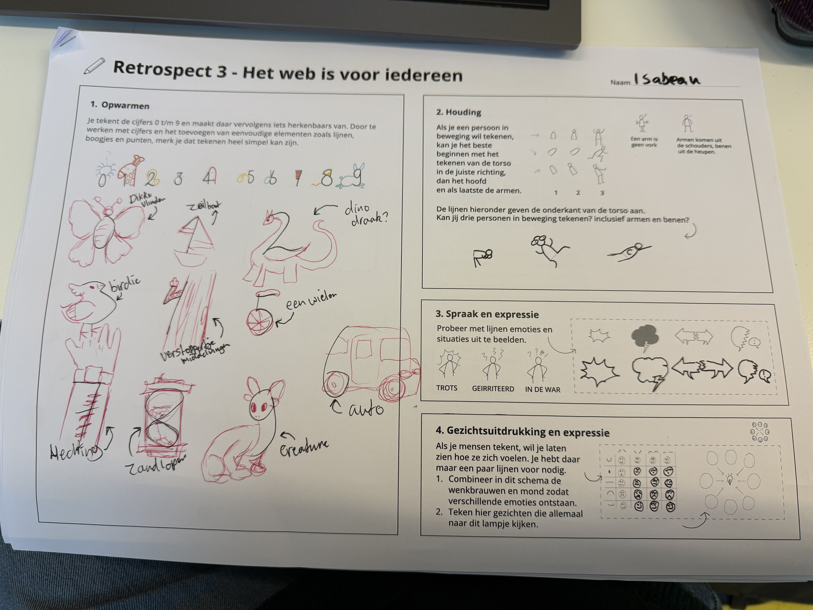

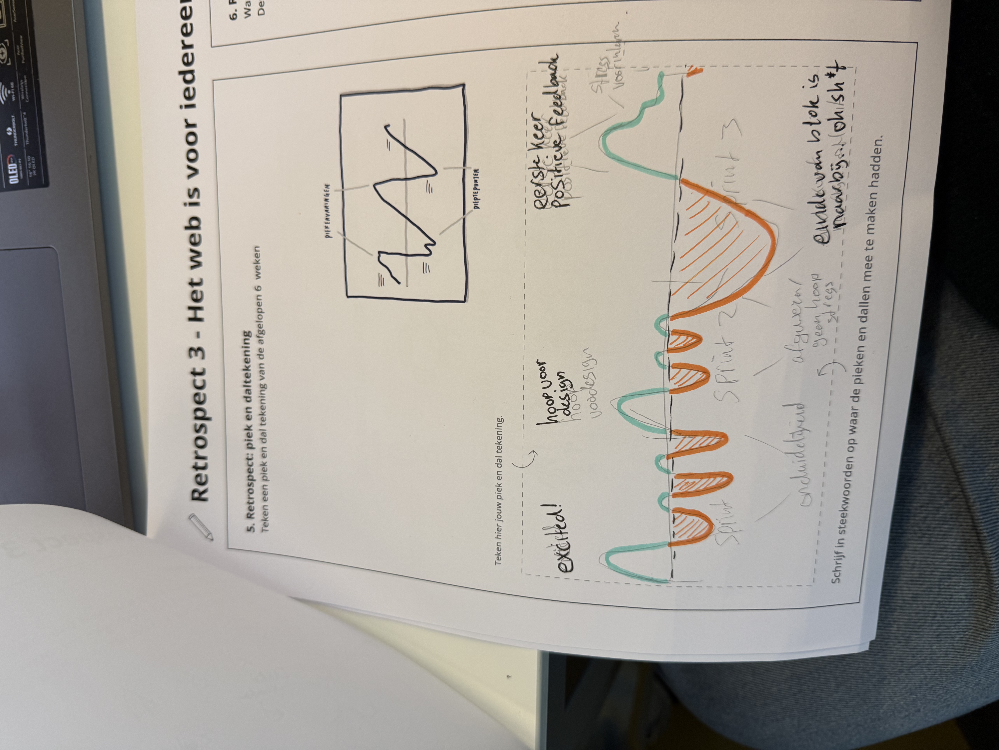

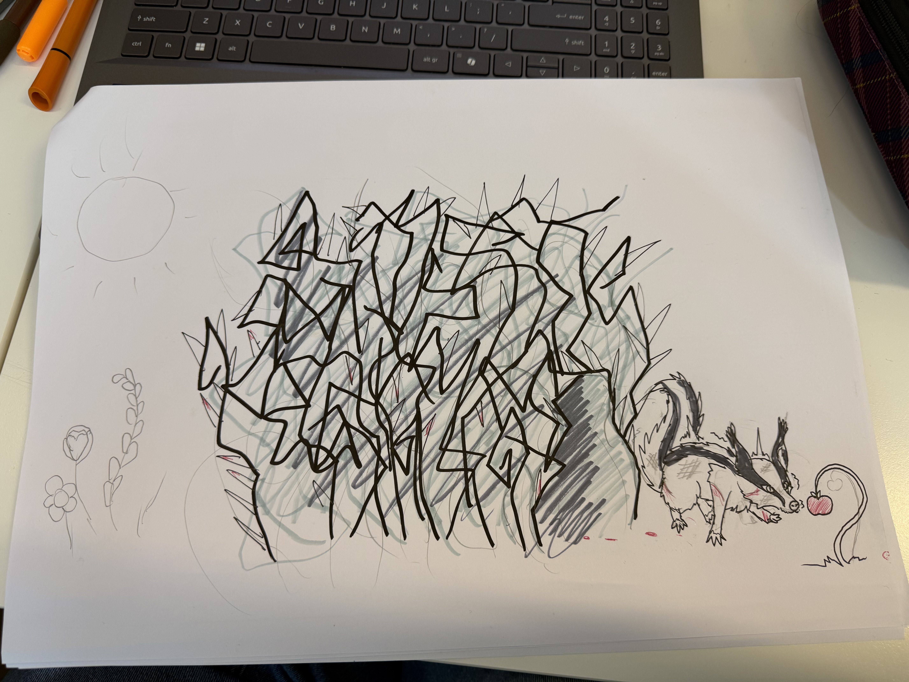

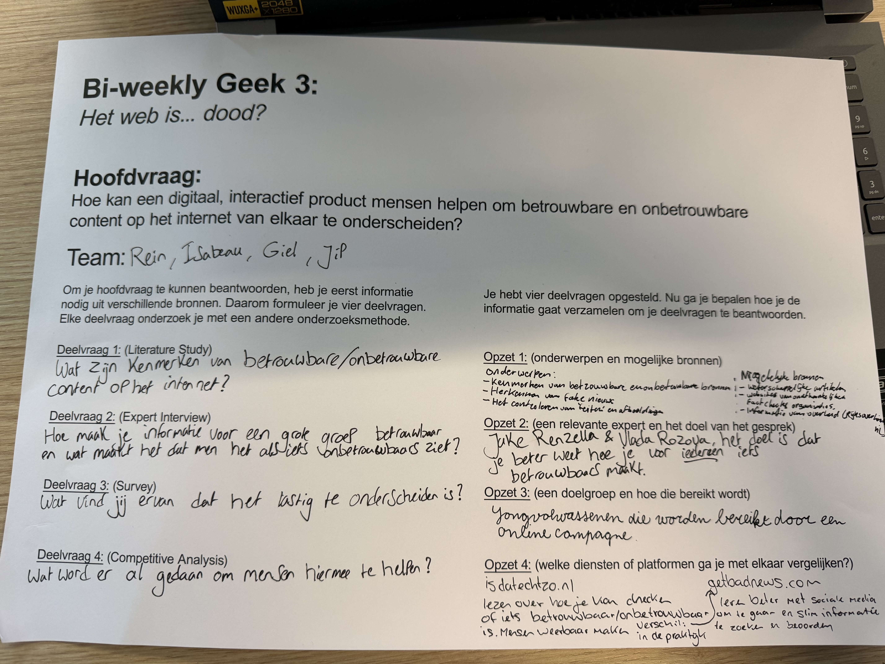

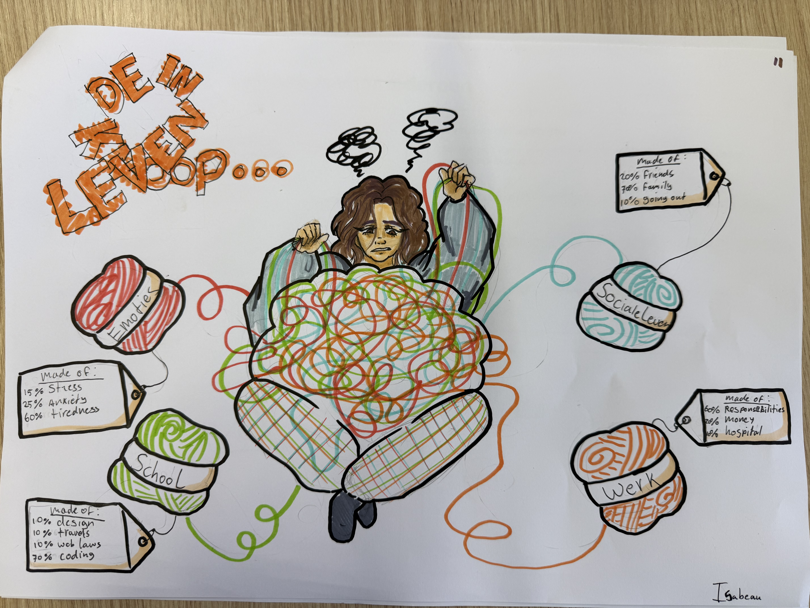

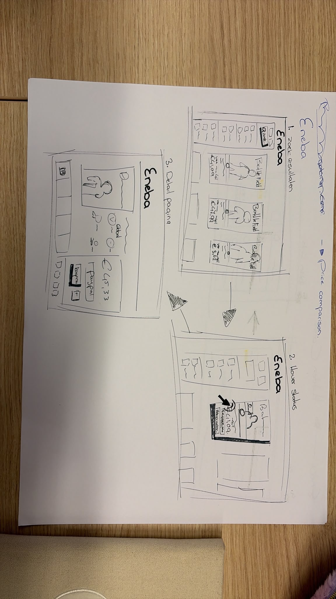

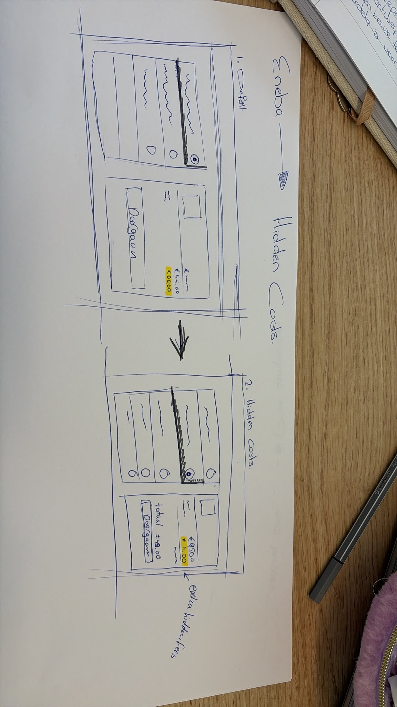

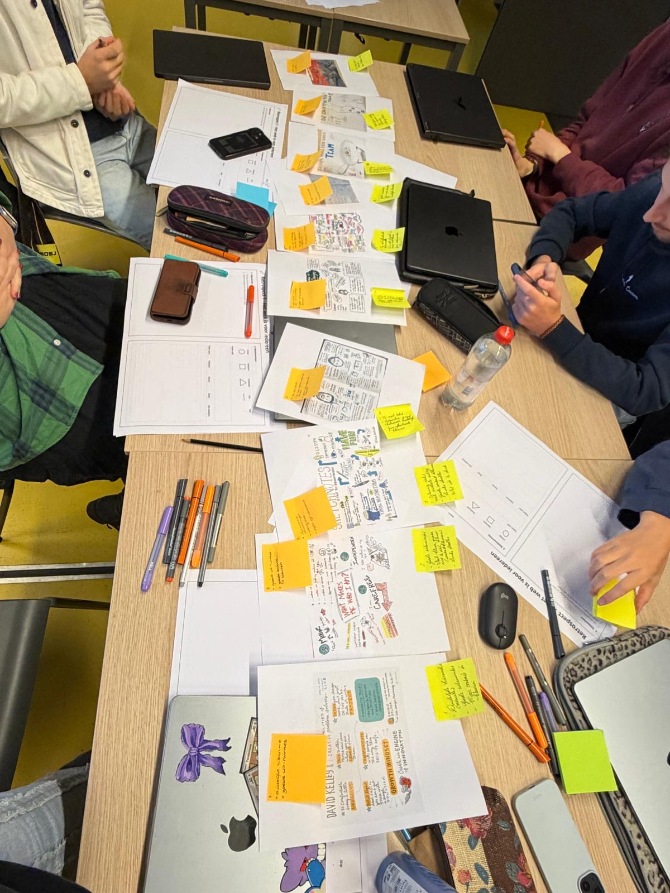

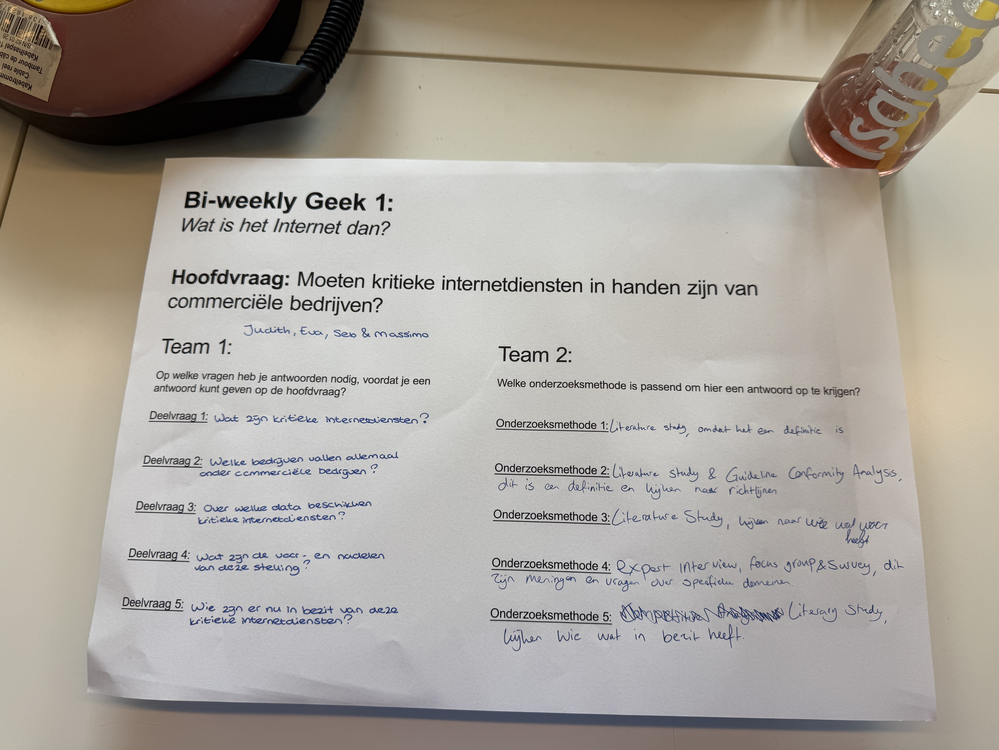

### Learning Log

 Beetje kijken naar componenten 

### Oriënteren en begrijpen

##### ❓ Waarom geven de docenten deze opdracht?

Volgensmij willende docenten dat we leren hoe we een eigen idee kunnen omzetten in een werkende website. Daarbij gaat het niet alleen om HTML en CSS maar ook om het begrijpen van de doelgroep, het maken van ontwerp keuzens en het kunnen uitleggen waarom we bepaalde dingen doen.

Voor mijn eigen website wilde ik iets maken dat persoonlijk bij mij past. Ik ben slechthorend en merk dat een drukke dag soms best veel energie kost. Creativiteit is voor mij een manier om even tot rust te komen en in mijn eigen wereld te zitten. Of het nou tekenen is, koken, cocktails maken of boeken lezen. Ik wil de gebruikers niet alleen iets latem zien, maar ok een beetje begrijpen hoe het is voor een persoon zoals ik.

##### ❓ Welke technieken gebruik ik?

HTML gebruik ik om de structuur van mijn website te maken. CSS om de vormgeving en opmaak te regelen. Ik heb gewerkt met achtergronden, afbeeldinge, clickables en verschillende lettertypes en kleuren.

Daarnaast heb ik JavaScript gebruikt voor onderdelen die interacteis nodig hebben, zoals het openen en sluiten van dialogen. Ik merk dat ik dit nog erg lastig vind om hett zelfstandig te schrijven en eigenlijk was dit allemaal een extra uitdaging... maar toch wil ik proberen te begrijpen wat de code doet en waarom ik bepaalde technieken nodig heb. Ik wil hier uiteindelijk steeds zelfstandiger in worden zodat ik niet meer de heletijd van de ene artikel, naar de andere video, naar mijn code moet alt+tabben... bah...

##### ❓ Wat zijn de randvoorwaarden?

Nou ik moet een werkende website opleveren die aansluit bij de opdracht van dit blok. Ook moet ik mijn proccess ducumenteren, mijn bronnen vermelden en rekening houden met de toegankelijkheid en andere beooordelings criteria.

##### ❓ Wat kan er allemaal met CSS?

Je kan eigenlijk een stuk meer met CSS dan dat ik dacht. Dus niet alleen kleur, lettergrootte of margins en paddings, maar ook afbeedlingen op de juiste plek zetten met positions of grids of flex.

### Verbeelden en conceptualtieseren

##### ❓ Lukt het om verschillende ideeën te bedenken?

Ja ik heb tijdens het process verschillende ideën onderzocht voor mijn website. Ik wilde iets maken waarin mijn creabea en ervaring met slechthorendheid samen komen. I plaats van alleen informatie over slechthorendheid te geven.

Mijn concept is onderweg veranderd en duidelijker geworden. Ik heb gemerkt dat ik soms heel veel ideeën tegelijk heb, maar dat niet ieder idee automatisch bijdraagt aan het einresultaat. Nay I say. Ik moest daarom keuzes maken en bepalen welke onderdelen mijn verhaal het beste vertelllen.

##### ❓ Lukt het om je ideeën te schetsen?

Net als wat ik net zei: "Ik heb gemerkt dat ik soms heel veel ideeën tegelijk heb,"
Hierdoor wil ik het liefst meteen beginnen met maken maken maken. trial and error. Toch helpt het wel om eventjes stil te staan bij indeling en de bedoelingen van per onderdeel.

### Prototypen en uitwerken

##### ❓ Begrijpen bezoekers de site?

Aan de hand van de expo en (stiekem) observeren hoe mijn mede studenten mijn webiste gebruiken, kan ik zeggen dat het erg soepel gaat. Het heeft vertrouwde funties zoals de nav balk/hamburger menu. scroll funtie op telefoon, je kan klikken op objecten etc etc.

Ik ga in de toekomst zeker door mensen, buiten, deze studie het laten testen. Misschien mijn ouders die zeker wel bekent zijn met telefoons, maar toch 1 of 2 generaties achter lopen... of zelfs mijn oma en opa die vooral de ipad gebruiken.

##### ❓ Wat vindt de opdrachtgever er van?

Mijn docenten zijn degenen die mijn werk beoordelen en feedback geven dus ik zie ze even als mijn opdrachtgever. Tijdens mijn gesprekken met Diederik kreeg ik eerst altijd de "Ja oke, maaaaaar..." Het was erg frustrerend aangezien elke feedback moment ik al wist wat er mis was, alleen had ik nooit de tijd gehad om het te perfectioneren omdat ik mijn website wel ongeveer 5 keer helemaal opnieuw moest coderen.

Pas in de laatste 2 weken heb ik te horen gekregen dat was ik heb, leuk was... nou kon bijna janken van geluk. Eindelijk was het soortvan okay.

### Evalueren

##### ❓ Wat wil(de) ik weten/bereiken?

Ik wilde een website maken die echt bij mij past en waarin mijn ervaringe met slechthorendheid, overprikkeling en creativiteit samenkomen.
Ik wilde niet alleen uitleggen hoe het is om slechthorend te zijn, maar over het verhaal achter mijn concept te leren.
Mijn doel was omm mijn idee om te zetten in een werkende website en ondertussen meer te leren over HTML, CSS en de interacties die mogenlijk zijn met JavaScript.

##### ❓ Wat heb ik gedaan?

Ik heb verschillende ideeën onderzocht, mijn concept verder ontwikkeld en gewerkt aan de vormgeving van mijn website. Ik heb de achtergronden en andere visuele onderdelnen gemaakt en dezen met MHTL en CSS in mijn website verwerkt. Daarbij ben ik ook gaan werken met navigatie, klikbare objecten, dialogen en, of course, de light en dark mode. Ik wil later echt zelfstandig de JS funties uit mijn hoofd kunnen schrijven... zodat ik niet de heletijd meer hoef te tabben van ene pagina naar andere.

Niet alles ging zoals planned... Ik heb te vaak moeten wisselen waardoor er bepaalde ideeën afgeschaft moesten worden waar ik later opzich wel spijt van heb... maar ik weet wel dat mijn tijd te kort was.

##### ❓ Wat vond je (niet) leuk?

Ik vond het begin van het denken en stormbrainen over wat voor website ik wil maken het leukst. De keuzes zijn reuze! Het coderen was redelijk leuk, alleen omdat ik een ingewikkelde website layout had, was het niet te doen met de functies van de deepdives alleen met de basics. Ik heb echt heel veel zelf studie moeten doen tijdens herfst reccess... raaaah! Maar het wel leuk om te zien wanneer een JS funtie eindelijk... functioneert!

##### ❓ Voldoet het nog aan de eisen?

Ik heb echt voor mijn gevoel aan de citeria gehouden:

- Het is fluid en adaptief!
- het is ZEKER INTERACTIEF!
- Het is zeker toegankelijk met de tab knop, oplezen van, en wat ik heb gezien bij apple users kon je zien wat de knoppen waaren enzo.
- Het is volwassen, mijn cookies geven netjes aan wat voor gegevens gebruikt worden en waar.
- nou... Ik denk dat er geen twijfel is aan het expressieve gedeelte... Het straalt persoonlijkheid uit EN niemand kan het zomaar na apen van mij :)
- Het is zeker leuk, verassend en uniek!
- Ik heb geprobeert om zo min mogenlijk spans, divs, id's, classes te gebruiken (naast de sontext waar je het wel mocht gebruiken) alleen met mijn website en mijn kennis, moest ik wel. Voor veel dingen was een consistente CSS code doable, maar omdat veel dingen zo anders zijn, moest ik wel aparte id's en classes en divs gebruiken. Het kon niet anders... :(...

extra

##### ❓ Is de HTML die je hebt geschreven nog wel valide? Check het regelmatig, hiermee voorkom je onverklaarbare fouten. En klopt de HTML wel? Gebruik je de juiste elementen op de juiste plek?

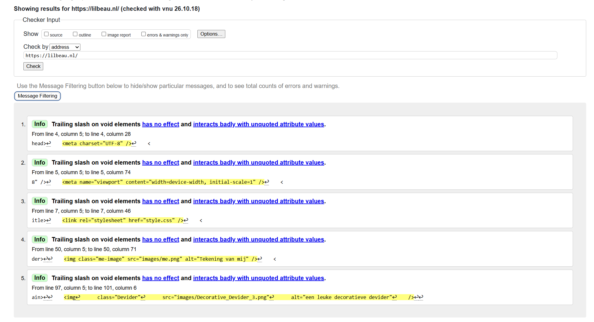
foto: Screenshot van mijn website html validator check

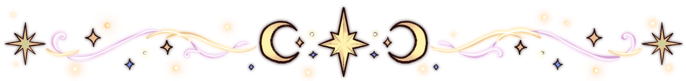

 Final feedbacks en expo 

### Reflectie op de feedback van mijn website

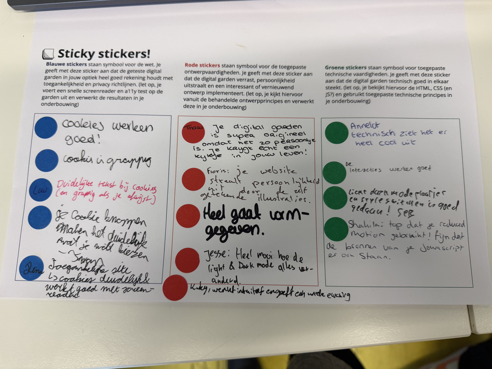

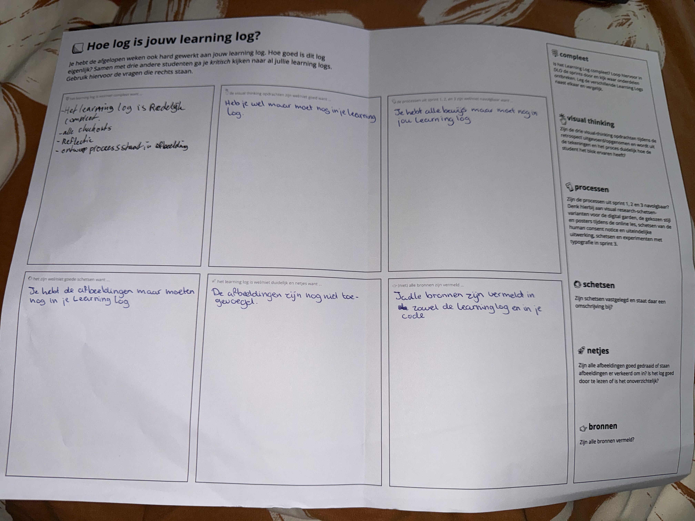

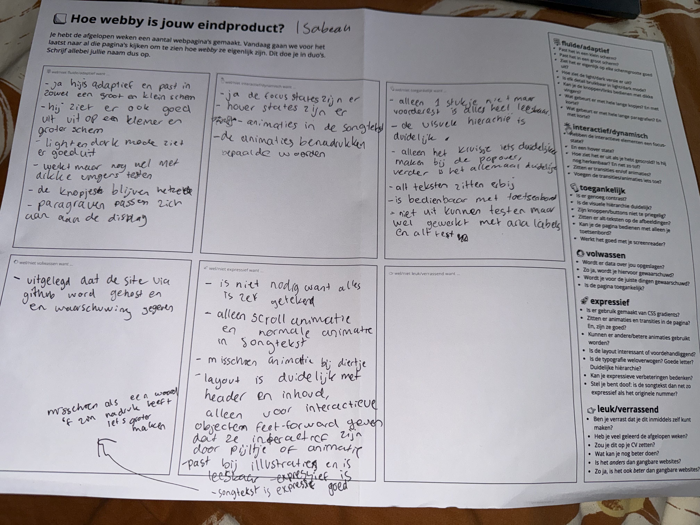

Uit de feedback die ik van mijn mede studenten heb gekregen blijkt dat mijn website een persoonlijkeen creatieve uitstraling heeft. Ze vinden dat mijn digitale tuintje origineel is en goed bij mij past (vooral de mensen die mij ook echt kennen), omdat mijn eigen illustraties en ervaringen erin terug komen. Ook de cookies kregen een leuke opmerkingen zals hoe grappig het is.
Ik vind het fijn om te zien dat mijn persoonlijke stijl duidelijk naar voren komt en dat mijn website daardoor anders is dan een standaard website.

Daarnaast kreeg ik positieve feedback over de technische uitwerking. De interacties werken goed en er is aandacht besteed aan toegankelijkheid, zoals het gebruik van labels, toetsenbordbediening en hoe klikbaar knoppen zijn (voor dikke vingers of mensen met tremoren). Dit is ook een check voormijzelf dat ik niet alleen bezig ben geweest met de visuals, maak ook echt rekening heb gehouden met de a11y :)

Natuurlijk zijn er ook verbeterpunten die ik uit mijn feedback heb kunnen halen. Ik moet de interactiefbare clickables een kleine animatie maken zodat mensen een kleine indicatie hebben van wat klikbaar is.
Voor de rest doet de screenreader menu het, alleen kom ik niet zo ver met mijn windows laptop om het ook iedere keer te checken... Maar van alle keren dat ik het bij apple users het hebben kunnen zien, werkt het prima!

Wat is dus meeneem uit al deze feedback, is dat een creatief en persoonlijk ontwerp goed kan samengaan met toegankelijkheid en techniek. Ik heb geleerd dat het niet genoeg is om een website er goed uit te laten zien.

Voor de volgende keer zou ik visual zeker nog meer willen verbeteren en meerdere verschillende interacties met objecten willen hebben... Wat alleen een informatieve site is een no-go for me. Het moet leuk ÉN educatief zijn. exploring!

 

 Sprint 3 

### Procesdocumentatie - Digital Garden

##### 1. Het oorspronkelijke idee

Mijn oorspronkelijke idee was om een persoonlijke website te maken die niet alleen als een portfolio functioneert, maar ook als een interactieve digitale wereld. Ik wilde mijn interesses zoals tekenen, lezen, bakken en creative projecten, op een visuele manier presenteren.

Ik wilde voorkomen dat mijn website eruit zou zien als een standaardportfolio met alleen tekst, een paar afbeeldingen en losse pagina's. Daarom koos ik voor een fantasierijke omgeving waarin bezoekers verschillende ruimtes kunnen ontdekken en objecten kunnen klikken om meer informatie te bekijken.

##### 2. De ontwikkeling an het ontwerp

Tijdens het ontwerpprocess heb ik verschillende ideeën uitgewerkt. In eerste instatie dacht ik aan een grote website met meerde ruimtes en aparte pagina's voor verschillende onderwerpen. Hierbij kwamen onder andere een portfolio, boekenplank, keuken, art studio en contactmogelijkheden aan bod. Het was allemaal te veel waardoor mijn pagina helemaal niet uitkwam hoe ik het wilde...

Ik kreeg daarom feedback van mijn docenten dat de website te saai was en dat ik mij beter op2 of 3 pagina's kon concentreren dan op 8 aparte HTML pagina's. Hierdoor moest ik opnieuw nadenken over de hoeveelheid pagina's en de manier waarop ik mijn ideeën kon uitwerken.

In plaats van iedere pagina uitgebreid te maken, ben ik meer aandacht gaan besteden aan de visuele uitwerking en interactie met javascript. De keuken, slaapkamer en woonkamer kregen allemaal hun eigen achtergrond en interactieve elementen.

Uiteindelijk is het mij zeker gelukt om een deel van mijn idee uit te kunnen werken en is het persoonlijker geworden door bijna alles zelf geïllustreert te hebben.

##### 3. Technische uitdagingen

Één van de grootste uitdagingen was het combineren van mijn eigen illustraties met interactieve webtechnieken. Ik wilde dat de afbeeldingen niet alleen decoratief waren, maar ook als onderdeel van de interface konden functioneren.

Daarbij moest ik leren hoe HTML, CSS en JavaScript samen werken. HTML bepaalt de structuur van de pagina, CSS verzoorgt de vormgeving en JavaScript maakt interacties mogelijk.

Vooral JavaScript vond ik uitdagend. Ik moest onder andere begrijpen hoe elementen worden geselecteerd, hoe gebeurtenissen zoals klikken worden afgehandeld en hoe de website op basis daarvan iets kan openen, sluiten of veranderen.

Ook de dag en nacht modus vroeg om extra aandacht naast de root; functie in css omdat ik dag en nacht versies van de kamer achtergronden heb gemaakt. De juiste achtergrond moest worden gekozen op basis van de geselecteerde modus en de gekozen instellingen moesten behouden blijven wanneer de gebruiker de website opnieuw opent.

De trial and error was echt zo pijnlijk aangezien alles nog niet zo soepel gaat. Ik moest echt heen en weer van mijn pagina, naar artikellen en video's kijken wat er in vredensnaam mis is gegaan. Gelukkig had ik een hele Herft recess daarvoor. :)

##### 4. Gebruikte bronnen en hulpmiddelen

Tijdens het ontwikkelen heb ik veel online documentatie en hulpmiddelen gebruikt om technieken op te zoeken, voorbeelden te begrijpen en oplossingem voor technische problemen te vinden.

voor HTML, CSS en JavaScript heb ik de volgende documentties kunnen gebruiken en studeren:

- MDN Web Docs voor JavaScript functiess, events en browserfunctionaliteiten
- web.dev voor de basis van HTML, CSS, JavaScript en toegankelijk webdesign.
- De documentatie over querySelector() (hoe vindt de code het juiste element) en addEventListener() (hoe reageert de website op een klik?) om te begrijpen hoe interactieve elementen werken.
- De documentatie over LocalStorage om te begrijpen hoe voorkeuren in de browser bewaard kunnen blijven.

Daarnaast heb ik ChatGPT alleen gebruikt voor als hulpmiddel als ik bepaalde problemen echt niet kon spotten tijdens het nalezen van documentaties en artikkelen en videos. Echt als PLAN Z.

Mijn eigen illustraties heb ik gemaakt als onderdeel van het visuele ontwerp.

##### 5. Wat heb ik geleerd?

Ik heb geleerd dat een website niet alleen draait om het uitelijk, maar ook op de manier waarop gebruikers ermee omgaan. Een goed idee moet worden vertaald naar een duidelijke structuur en begrijpelijke interacties.

Daarnaast heb ik geleerd dat het ontwikkelen van een website een iteratief proces is. Het eerste idee hoeft niet het uiteindelijke ontwerp te worden. Feedback, experimenteren, technische beperkingen en het testen van functies kunnen ervoor zorgen dat een ontwerp verandert.

Ook heb ik ervaren dat het belangrijk is om te begrijpen wat code doet, zelfs wanneer ik documentatie of hulmiddelen gebruik om de code te schrijven. Ik nu nogsteeds niet alles uit mijn hoofd opschrijven, maar de docenten hebben gelukkig zelf gezegd dat het bijna onmogelijk is om het uit je hoofd te leren en dat zelf zij er veel moeite mee hebben.

##### 6. Evaluatie en verbeterpunten

Ik ben tevreden met de ontwikkeling van het concept, omdat de website steeds beter aansluit bij mijn persoonlijke stijl en mijn intresse in illustratie en visueel ontwerp.

Een belangrijk verbeterpunt is dat ik mijn technische kennis verder wil ontwikkelen. Ik wil beter begrijpen hoe JavaScript functies zijn opgebouwd zodat ik in de toekomst veel soepeler kan typen inplaats van 3 minuten per regel besteden omdat ik heen en weer van tabblad naar tabblad moet klikken. Ik wil later interacties zelfstandig kunnen maken en aanpassen!

##### 7. Als ik meer tijd had

Als ik meer tijd had gehad, zou ik de interactieve wereld verder willen uitbreiden met verborgen elementen (eastereggs), uitgebreidere infromatie over mijn illustraties en extra mogelijkheden om tussen de verschillende ruimtes/kamers te navigeren.

Daarnaast zou ik meer gebruikerstests uitvoeren om te onderzoeken of gebruikers wel begrijpen welke onderdelen klikbaar zijn en hoe zij hun weg door de website vinden. Op basis van die resultaten zou ik de navigatie en interacties ver verbeteren.

Ook zou ik de toegankelijkheid van de website uitgebreider testen. Hierbij zou ik onder andere letten op contrast, kleuren blindheid, leesbaarheid enzov

### 🌸 8 okt -🌸

💚 Gewoon rond gespeeld met html en css voor mijn song text shizzle. Ik heb het wel simpel gehouden aangezien docenten aleen willen dat ik dingen gebruik die bij deepdives worden gegeven. dus heb alleen met grids en divs en classes gewerkt. Simpel, maar toch misschien wel iets leuks. Ik had meer keyframes animaties als eerste, maar later dacht ik "Nee doe maar niet want anders wordt er tegen je gezegd dat je niet zo veel moet doen."

💚 Feedback gekregen van docenten... Dus wat ik nu gaan doen is ervoor zorgen dat het een samenhangende flow heeft. misschien de 'noise' ietsjes rustiger maken. en alarm als je naar beneden scrolled ineens naar vooren laten schuiven en helemaal groot!

### 🌸 7 okt -🌸

 Songtext

#### 🌼De checkout vragen voor maandag 7 okt:🌼

##### ❓ Waarom is het goed om een grid in je ontwerp toe te passen? Noem een reden voor de ontwerper en een voor de bezoeker.

- voor ontwerper: Hept om elementem netjes uit te lijnen en structuur aan te brengen.
- Voor gebruiker: De website is overzichtelijker en makkelijker te gebruiken.

##### ❓ Noem drie manieren om chaos in je ontwerp te voorkomen.

- Gebruik een duidelijke visuele hiërachie.
- Houd voldoende witruimte.
- Gebruik consistente kleuren en lettertypes en uitlijningen.

##### ❓ Hoeveel gekkigheid moet er in je werk zitten?

genoeg om je ontwerp uniek en creatief te maken, maar niet zoveel dat het onduidelijk of onbruikbaar wordt.

 

 Sprint 2 

### 🌸 6 okt -🌸

💚 Ik heb eindelijk even rond kunnen spellen met verschillende keyframes/animaties die je kan maken in css... HEERLIJK om een keertje div/spans/classes mag gebruiken. yum... dus ik vond het wel leuk om bepaalde animaties te gebruiken op een woord te benadrukken. Dit vind ik gewoon leuk, ook om eventueel mijn kennis een beetje te testen van vorig jaar toen we het ook kort over keyframes hadden.

### 🌸 5 okt -🌸

#### 🌼De checkout vragen voor maandag 5 okt:🌼

##### ❓Leg uit wat er met de volgende termen bedoeld wordt: kerning, tracking, leading, flush-left, flush-right, centered, justified, indent, outdent, modular scale, movable type, focus punt, vijf soorten contrast, spatial tension. (Hint, alle termen staan in de artikelen die we samen gelezen hebben)

Kerning - de ruimte tussen twee specifieke letters. Bijv. de afstand tussen de A en V kan aangepast worden zodat het woord er optisch gelijkmatiger uitziet.

Tracking - De algemene letterspatiering van de hele tekst, woord of reeks van letters. Je maakt hiermee alle letters iets ruimer of dichter op elkaar.

Leading - de verticale ruimte tussen de tekstregels. Meer leading maakt een tekst luchtiger en vaak leesbaar.

##### ❓Wat is jouw ideale regellengte (measure)? Leg uit waarom.

##### ❓Als je in een ontwerp maar één variabele tot je beschikking had om hiërarchie aan te brengen (grootte, plaatsing, spacing, lettersoorten), welke zou je dan gebruiken en waarom?

### 🌸 2 okt -🌸

💚 Ik heb helaas door prive redenen niet heel veel kunnen doen tijdens mijn studiedag... toch nog soortvan vandaag dingen kunnen squeezen en aanpassen.
Ik wil nog de afbeeldingen in de popups zo allemaal kunnen aanpassen dat ze allemaal groot kunnen afgebeeld zijn in veschillende formaten (width: 40% werkt niet en width: auto ook niet...)

💚 daarbij haat ik het feit dat mijn schtergrond schetsen van intro verhaaltje nogsteeds niet af zijn... Ik snap het dat schetsen okay zijn. maar ik vind het verschrikkelijk...

💚 en daarbij moet ik nog de dag en nacht modus nog toepassen door de achtergrond van de woonkamer een dag modus nog te geven.

### 🌸 30 sept -🌸

#### 🌼De checkout vragen voor woensdag 30 sept:🌼

##### ❓Waar staat WCAG en A11y voor?

WCAG - Web content accessibility Guidelines
A11Y - het is een afkorting van 'accessibility'. A is de eerste letter en Y de laatste. de cijfer '11' staat voor de letters die er tussen in zitten.

##### ❓Wat vind je lastiger, je laptop/websites alleen met een toetsenbord bedienen of met een screenreader? Waarom? Waar moet je nog mee oefenen?

Nou ik vind een screenreader het lastigst aangezien die van mijne helemaal niet werkt.

##### ❓Met welke beperking rekening houden vind je het meest lastig? Vind je dat je beperkt wordt in wat je kunt ontwerpen? Of heb je al manieren gevonden om vanuit een solide basis - die voor iedereen toegankelijk is - allemaal leuke en mooie extra's toe te voegen als je bezoekers dat goed vinden?

### 🌸 28 sept -🌸

💚 Ik heb nog een paar afbeeldigen erbij toegevoegd.

#### 🌼De checkout vragen voor maandag 28 sept:🌼

##### ❓ Wat bedoelt Vasilis met de uitspraak: Semantiek doet mij niet zo veel, ik ben liever bezig met de UX van HTML?

Het boeit hem niet hoe de funties in codes heten, gewoon hoe het eruit ziet.

##### ❓ Wat voor type beperkingen hebben invloed op het gebruiken van websites?

- Kleurenblindheid
- cognitieve beperking
- Motorieke beperkingen
- Zichtelijke beperkingen
- Auditieve beperkingen

##### ❓ Noem drie manieren om door een website te navigeren met jouw screenreader.

- Tab
- Enter
- Spatie

### 🌸 26 & 27 sept -🌸

💚 Ik ben weer terug gegaan naar mijn idee van een point en click functie. Eerst dacht ik dat het onmogelijk was om een image op een vaste plek te houden. Ik heb een andere klasgenoot gezien en dacht "nah, nu moet ik het wel doen."

dus ik heb echt de tijd genomen om videos en artikkelen te lezen over hoe javascript en css werkt en hoe ik daarmee verder kan en mijn eigen iedeen toe kan passen. het was super pittig en achteraf kan ik sommige dingen nog steeds niet uitleggen wat wat doet, maar ik volg de instructie en door trial en error en erme te spelen, lukte het soortvan. Hier zijn wat bronnen:

1. W3Schools — How To Create a Slideshow
   https://www.w3schools.com/howto/howto_js_slideshow.asp

2. W3Schools — Slideshow Gallery
   https://www.w3schools.com/howto/howto_js_slideshow_gallery.asp

3. Programming Duck — Carousel Slider Tutorial with HTML, CSS and JavaScript
   https://programmingduck.com/articles/javascript-carousel

4. Programming Duck — Carousel Slider Tutorial (YouTube)
   https://www.youtube.com/watch?v=QruodbmSq0A

5. Florin Pop — Create a Modal (Popup) with HTML/CSS and JavaScript
   https://www.youtube.com/watch?v=XH5OW46yO8I

6. Jason Watmore — Vanilla JS + CSS Modal Popup (Dialog) Tutorial
   https://jasonwatmore.com/post/2023/01/04/vanilla-js-css-modal-popup-dialog-tutorial-with-example

7. MDN — EventTarget.addEventListener()
   https://developer.mozilla.org/en-US/docs/Web/API/EventTarget/addEventListener

8. MDN — Window.matchMedia()
   https://developer.mozilla.org/en-US/docs/Web/API/Window/matchMedia

9. MDN — Web Storage API / localStorage
   https://developer.mozilla.org/en-US/docs/Web/API/Web_Storage_API

10. W3Schools — W3.JS Slideshow
    https://www.w3schools.com/w3js/w3js_slideshow.asp

💚 aangezien de cookies/privacy dingen niet echt werken met github enzo, ga ik alleen een informatieve cookies popup. De gebruiker kan alleen maar accepteren/doorgaan... dussssss...

### 🌸 23 sept -🌸

💚 Ik heb decorative deviders gemaakt die de opmaak en sfeer van mijn website meer whimsical maakt! :) Ben er best trots op, aangezien het goed te zien is in lightmode, maar vooral in darkmode. love ittttt!

 

 Sprint 1 

### 🌸 18 t/m 21 sept -🌸

💚 Heb vooral deze dagen mijn huidige wesite code een beetje aangepast en zitten spelen met kleuren en visuals. Ook heb ik wel wat meer persoonlijker textjes er in gedaan. Dat werd tijdens mijn feedback moment vertelt, maak het meer persoonlijker. Ook nog aan mijn kleine comic gewerkt, zeker nog niet af, alleen misschien gooi ik een tijdelijke digitale schets versie daarvan erin.

#### 🌼De checkout vragen voor vrijdag 21 sept:🌼

##### ❓ Wat zijn HTML landmark role elements?

Landmark elements zijn HTML-elemneten die belangrijke onderdelen van een webpagina aangeven. bijvoorbeeld: header, nav, main, aside, footer en section.

##### ❓ Wat zijn heading elementen en hoe horen deze 'genest' te worden?

Heading elementen zijn de koppen van je content, dus h1 t/m h6. Ze geven je hierachie van je informatie aan.
Je moet dus niet zomaar een h3 of een h5 gebruiken omdat je de text grootte toevallig kleiner of mooier vind. De heading niveaus beschrijven de scructuur, niet de vormgeving. DAAR HEB JE CSS VOOR!

##### ❓ Hoe ga jij met cookies om? Beschrijf jouw beweegredenen en of die zijn veranderd na het volgen van dit college.

Ik zal er bewuster mee omgaan, vooral als het een onbekende website is. Ik heb tot nu toe al vooral van 'alleen de noodzakelijke cookies' accepteren als het echt niet kan. maar anders weiger is sowieso alles wat ik kan.

### 🌸 15 en 16 sept -🌸

💚 Ben tot een realisatie gekomen dan mijn concept nog veelste moeilijk is voor iemand met mijn skills. opzich zou ik het kunnen doen, maar aangezien de te korte tijd die ik heb gekregen, heb ik het maar (voorlopig) bij een simpele layout website gehouden met meedere pagina's dat te maken heeft met mijn hobbies en passies.

💚 Ik merk dat ik Grids echt wel lastig vind aangezien ik vakjes niet mag categoriseren met classes en ID's dus het moest erg consistent blijven enzo

#### 🌼De checkout vragen voor vandaag:🌼

##### ❓ Noem 3 Gestalt- of Design principes op en laat de ander uitleggen wat ze betekenen en doen.

- Visuele Hierachie: Zorgt ervoor dat de gebruiker direct ziet welke informatie belangrijker is dan de andere. Dat is aan te geven met grootte, kleur en positie.

- Nabijheid: Elementen die dicht bij elkaar staan, worden gelijk gezien als 'stukjes die bijelkaar horen'.

- Consistentie: Door dezelfde kleuren, vormen, typografie en interacties te gebruiken, weet de gebruiker wat je kan verwachten.

##### ❓ Een grid biedt ruimte om te spelen (vrijheid), maar tegelijkertijd ook eenheid en structuur (vastigheid). Wat wordt hiermee bedoeld?

Een grid geeft structuur en hoevast, omdat elementen op een bepaalde manier worden uitgelijnd. Terelijkertijd geeft een grid vrijheid, omdat je binnen die structuur kan spelen met grootte, positie en verdelingen van elementen.

### 🌸14 sept -🌸

💚 In mijn notities begonnen met mijn html lay-outs

#### 🌼De checkout vragen voor vandaag:🌼

##### ❓ Leg uit wanneer een website 'lelijk' wordt en geef voorbeelden wat je kan doen om deze 'lelijke' onderdelen te fixen?

Wanneer de vormgeving niet goed samenhangt. Bijvoorbeeld: Te veel verschillende kleuren, te veel verschillende lettertypes, geen hieracchie, alles staat te dicht op elkaar, onduidelijke navigatie, media (afbeeldingen, text, audio, env) horen niet bij elkaar.

##### ❓ Vertel welke volgende stap je neemt om je website responsive te maken.

Ik moet ervoor zorgenn dat het goed werkt op verschillende scherm formaten... :)
Ik ga dan eerst kijken hoe mijn ontwerp zich gedraagd op de schermen die ik heb (laptop en Iphone) en daarna kijk ik of ik flexbox, grid en media queries nodig heb om onderdelen mee te laten schalen en eventueel anders kan indelen.

##### ❓ Kun je het ontwerp en de bouw van je eigen Garden (zo uit je hoofd) onderbouwen in Webby vocabulair?

Mijn tuintje is een interactieve website met een point-and-click navigatie. De bezoeker ontdekt mijn projecten en interesses door verschillende ruimtes en elementen aan te klikken.

Ik gebruiken een vaste visuele stijl, kleurenpalet en illustratie stijl (mijn stijl) voor een duidelijke visuele identiteit en samenhang. Met visuele hierarchie maak ik duideijk welke onderdelen belangrijk en interactief zijn.

### 🌸11 t/m 13 sept -🌸

💚 Schetsen, tekenen. rondvragen aan mensen of mijn idee wel duidelijk is.

### 🌸10 sept -🌸

💚 Ik ben meer gaan schetsen. Concepten van achtergronden en concepten van sprites/clickables.
Hoe kan de bezoeker door mijn website heen?
mobiel versie.

### 🌸9 sept -🌸

#### 🌼De checkout vragen voor vandaag:🌼

##### ❓Leg uit waar het Visual Research in 3 stappen naartoe werkt

- stap 1: Je verzamelt veel visuele inspiratie rondom je design/onderwerp. Denk aan kleuren, vormen, typografie, illustratiestijlen, fotografie,websites/apps, sfeer. Vraag daarna aan jezelf: "Wat zie ik allemaal en wat spreekt mij aan?" Je doel is hier vooral ontdekken en nog niet meteen beslissen.

- stap 2: Je kijkt nu kritischer naar je verzameling. Welke kleuren komen vaak terug? Welke vormen geven een bepaalde sfeer? Waarom vind ik een bepaald ontwerp aantrekkelijk? Welke ontwerpkeuzes passen bij die van mijne? Je gaat dus van "oooooh wow dit vind ik mooi" naar "hmmm dit kan zeker goed werken in mijn design."

- Stap 3: Je vertaalt je onderzoek naar concrete keuzes voor je eigen ontwerp/concept/website. In mijn geval is het: Veel organische vormen zodat het natuurlijk en vriendelijk overkomt, zachte kleurgebruik met donkere details, veel interactieve elementen dat mijn website speels maakt waardoor het ook minder saai is.

##### ❓Vertel in 2 zinnen waar jouw Garden over gaat, en met welke content je dat gaat doen (beeld, tekst, sound, animatie enz).

Mijn garden is een interactieve point-and-click wereld waarin bezoekers door een gezellige cabin en een whimsical,euforische omgeving reizen om mijn interesses, creativitet en werk te ontdekken. Ik gebruik illustraties, kleine animaties, tekten, geluid en kleine interactieve elementen om mijn wereld speels tot levem te brengen.

##### ❓Vertel kort welk idee van de Crazy 8 je het liefst zou willen uitvoeren/ verder zou willen onderzoeken

--- (nog bezig)

💚 online school: inspiraties van posters opgezocht en eventueel elementen eruit halen die passen bij mijn website. Crazy 8 eruit gehaald, maar ik zal er nog 1 maken, want ik was niet tevrede met de eerste versie. (Ik wist niet echt wat ik moest schetsen).
Ik ben ondertussen begonnen met de eerste schetsen van mijn website. Wat zullen de bezoekers moeten zien? Hoe zet ik de achtergronden in en de light en dark modus (switchen van achtergrond als je op een lampen sprite klikt). Kijk Youtube video's en verdiep mijzelf erin.

### 🌸8 sept -🌸

💚 Ik heb vandaag voor mijn website een mindmap gemaakt over wie ik ben... wat natuurlijk belangrijk is als ik een persoonlijke website ga maken. Met hulp daarvan heb ik een paar puntjes eruit kunnen halen die ik eventueel wil laten zien. 50+ afbeelding opgezocht op pinterest die mij inspireren en video's opgezocht die mij kunnen helpen.

#### ❓Wat is voor jou de essentie van wat je hebt gepresenteerd qua onderwerp en geschreven/beeldende content? ​

De essentie is laten zien wie ik ben achter mijn werk. Ik wil niet alleen mijn projecten en vaardigheden laten zien, maar ook mijn persoonlijkheid, creativiteit, fantasiewereld en mijn ervaring als een slechthorend persoon. Door mijn website als een Cozy Cabin vorm te geven, kan de bezoeker mij ontdekken door verschillende kamers en interactieve elementen te verkennen.

#### ❓Welke woorden uit de kwaliteitenlijst kunnen passen bij je onderwerp?​

Woorden die goed bij mijn onderwerp passen:

- Persoonlijk
- Creatief
- Speels
- Warm
- Dromerig
- Interactief
- Vrolijk
- Toegankelijk
- Sfeervol
- Fantasierijk
- Ontdekkend
- Cozy

#### ❓Heeft 'de ander' een aanvulling op je onderwerp?​

Ze vond het al een heel leuke idee. Ze kent mij niet, maar ze merkte wel van de manier hoe ik het uitleg en praat, dat het wel bij mij past.

#### ❓Wat is het karakter/ de uitstraling/ het gevoel dat bij het onderwerp past? (bijv. stoer, hip, vrolijk, dynamisch, eenvoudig, enz.)

Mijn partner waar ik samen hierover moest hebben zei dat ze het volgende vind als ze kijkt naar mijn inspo's en mijn uitleg:

- Euforisch
- Cute
- Dynamisch

### 🌸7 sept -🌸

Opdracht 2 - Eigen verkenning -
Ik denk dat ik van mijn garden een soort van simpele 'point-and-click'-game ervan wil maken. Ik wil een persoon 'meenemen' in een soort van cozy fantasie-rijke omgeving. Ik leef natuurlijk in het heden en ben vaak realistisch, maar toch een beetje dagdromen en random fantasy creatures maken is toch ook soms wel okay.

- de toon - Cozy, vriendelijk, fantasy
- de inventarisatie -
- het soort content - point and click and read en beleven
- verschillende ervaringen - Voelen en horen.

#### 🌼De checkout vragen voor vandaag:🌼

##### ❓Leg uit wat een digital garden is en waarom dat anders is dan een reguliere website.

Een digitale garden is een persoonlijke website waar je jouw ideeën, interesses en werk op een creative manier verzamelt. Het is anders dan een gewone website, omdat bezoekers zelf kunnen rondkijken en ontdekken... in plaats van een vaste route volgen.

##### ❓Leg uit wat een website 'webby' maakt en welke websites jou het meeste inspireren.

Een website is 'webby' als je echt gebruik maakt van bijvoorbeeld interactie, animaties, links en geluid. Het voelt dan niet alleen als een digitale document, maar als een plek waar je doorheen kan klikken en ontdekken.

##### ❓Vertel waar jij mee aan de slag wilt gaan bij het maken van jouw eigen digital garden (let op: dit zijn jouw eerste ideeën, dit kan en mag veranderen in de loop van het programma.

- Cozy Cabin: Bezoekers lopen door een magische cabin en iedere kamer bevat mijn interesses waar ze op kunnen klikken en ontdekken.
- Enchanted Forest: Leuke bos waarin elke plek iets over mij, mijn werk en creativiteit vertelt.
- Dream World: Zwevende eilanden die in de wolken zitten.
- Art Studio Room:1 kamer met mmeerde interactieve elementen.
- Fantasy Town: Een kleine dorpje waarin verschillende gebouwen verschillende onderdelen van mijn persoonlijkheid en interesses laten zien.

 

 Sprint 0 

### 🌸4 sept - Workshops🌸

💚 -Typografie-
Ik heb geleerd hoe ik door hulp van woorden te associeren met een persoon, lettertypes te vinden op google-fonts. combineren en mixen.

💚 -Schetsen-
Leren hoe ik uit mijn pols de volgende kan tekenen: Rechte lijnen, vierkantjes, ,grids rooster, Iphone size.
Daarnaast heb ik ook animaties 'geschetst' wat al best lastig is... Maar er zijn gelukkig geen regels daarvoor, alleen dat het duidelijk moet zijn voor jezelf en anderen.

### 🌸2 sept - [Workshop]🌸

- MMD, Micro-animatie -
  Ik heb een Wok menu kaart veranderd in een online keuze menu.

- fonts met kleuren in css -
  Ik heb ook geoefend met CSS en spelen met letters en kleuren.

### 🌸31 aug - Kickoff🌸

💚 Een fork van de model repository gemaakt en gepubliceerd via mijn eigen Github omgeving.
Ik had heel veel moeite met het opstarten en aanmaken en connecten van github en mijn domein. :(

#### 🌼De checkout vragen voor vandaag:🌼

##### ❓Leg uit wat een source hosting platform is en voor welke jij gekozen hebt.

Een source hosting platform is een online platform waarop je de broncode van een website kunt opslaan, beheren en delen. Je kunt er bijvoorbeeld HTML, CSS en JS bestanden bewaren. Een belangrijke voordeel is dat je via zo'n platform ook je website online kunt publiceren.

Voor mijn website heb ik gekozen voor GitHub en GitHub Pages. Github gebruik ik om mijn code en bestanden te bewaren en met Pages kan ik deze bestanden vervolgens als website op internet publiceren.

##### ❓Vertel welke domeinnaam jij gekozen hebt en hoe je die hebt gekoppeld aan jouw pagina.

Voor mijn website heb ik de domeinnaam lilbeau.nl gekozen.

##### ❓Beschrijf hoe je aanpassingen aan jouw pagina kunt maken en hoe je er voor zorgt dat die op het web gepubliceerd worden.

commit - sync changes - refresh page - bwam
